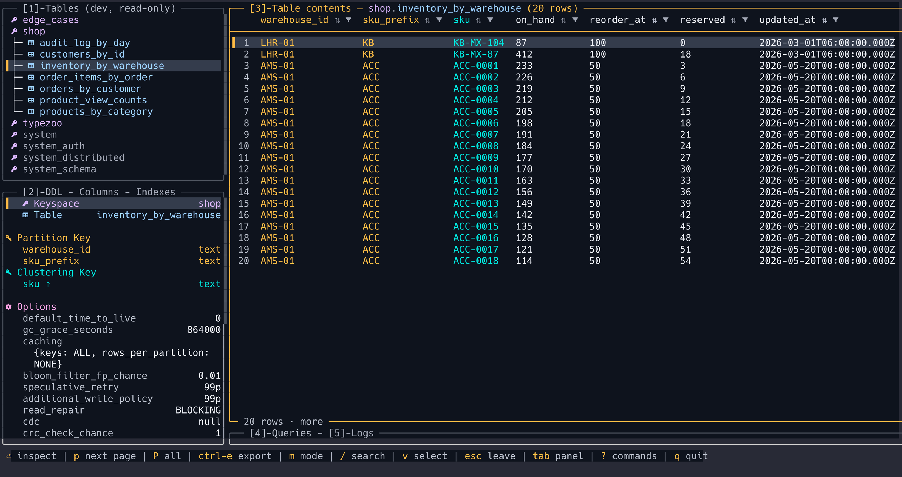
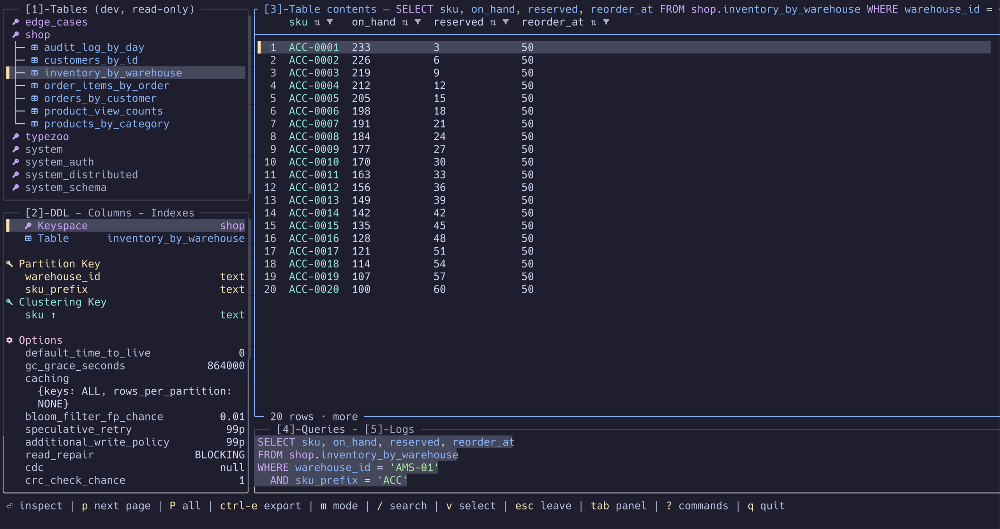
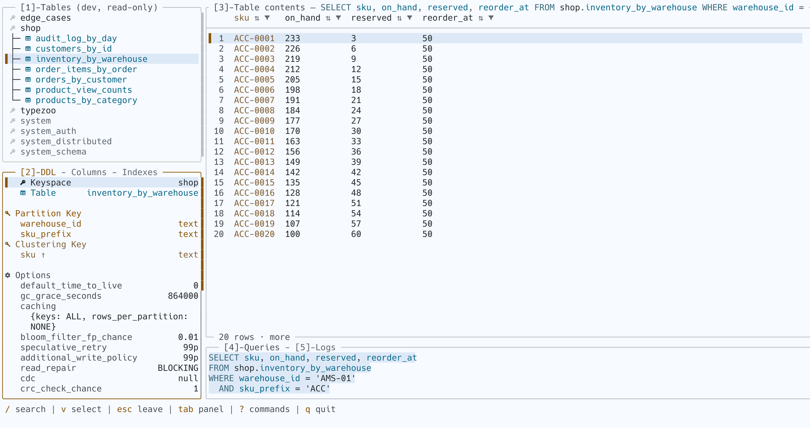
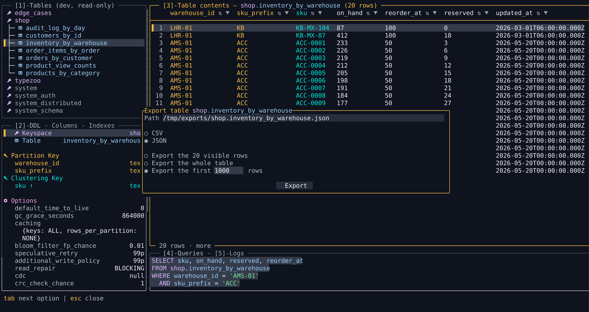

# LazyCassandra

**Your Cassandra cluster, a few keystrokes away.**

LazyCassandra is a terminal UI for developers and DBAs who work with Apache
Cassandra. Browse tables, inspect their schema, run CQL, and export results
without leaving your terminal. Vim-inspired navigation and a lazygit-style
panel layout keep your data and its physical shape side by side.



- **See the data model.** Partition keys, clustering order, columns, indexes,
  and table options alongside your rows.
- **Write CQL with context.** Schema-aware completion, highlighting, formatting,
  an external editor, and a session log.
- **Explore and export.** Paging, local sorting and filtering, full-value
  inspection, clipboard selection, and CSV/JSON exports.
- **Control writes.** Read-only by default, with CQL previews before committing
  cell edits, inserting or deleting rows.
- **Check table health.** Per-node storage, latency, tombstone and compaction
  readings from `system_views`, flagged against the node's own thresholds.

## In action

<details>
<summary>Queries, schema, and exports — three more themes</summary>

**Query a partition · Catppuccin Mocha**



**Inspect keys and table options · Quill Light**



**Export CSV or JSON · Beacon Dark**



</details>

Screenshots use sample data rendered by the app. Pick from twelve built-in
themes with `Ctrl-t`, preview them live, or define your own.

## Get started

### Compatibility

LazyCassandra supports Apache Cassandra 4.x and 5.x. The integration suite
currently runs against Cassandra 5.0.8; coverage of 4.x is planned.

Linux and macOS are supported. Windows users can build and run LazyCassandra
under WSL. A terminal with true-colour support works best. Icons use a Nerd
Font; set `icons = false` if you prefer a regular font.

### Install with Homebrew

On macOS or Linux:

```sh
brew install ike-forge/tap/lazycassandra
```

### Install from source

Building requires Git, a C/C++ compiler, and Rust 1.97.1. Clone the repository
and install the locked source:

```sh
git clone https://github.com/ike-forge/lazycassandra.git
cd LazyCassandra
rustup toolchain install 1.97.1
cargo +1.97.1 install --path crates/lc-app --locked
```

If you use [mise](https://mise.jdx.dev/), it can install the pinned toolchain
instead:

```sh
git clone https://github.com/ike-forge/lazycassandra.git
cd LazyCassandra
mise install
cargo install --path crates/lc-app --locked
```

The first launch writes a commented config to
`~/.config/lazycassandra/config.toml`. Add your cluster under
[`[[connections]]`](#configuration), then launch:

```sh
lazycassandra --connection dev
```

`Enter` expands a keyspace or opens a table. `4` opens CQL; `Ctrl-r` runs the
current statement. `?` opens the searchable command palette.

## Shortcuts

The bottom bar shows contextual actions; `?` lists all commands.

| Keys | Action |
| --- | --- |
| `1` / `2` / `3` / `4` / `5` | Tables / DDL / contents / CQL editor / session log |
| `Tab` / `Shift-Tab` | Next / previous panel or tab |
| `[` / `]` | Previous / next tab; repeat `2` to cycle DDL, Columns, Indexes |
| `h` `j` `k` `l` / arrows | Navigate the tree or grid |
| `g` / `G` · `Ctrl-u` / `Ctrl-d` | First / last row · page up / down |
| `/` · `n` / `N` | Search · next / previous match |
| `Enter` | Open a table; inspect a row or cell in contents |
| `m` · `v` · `y` | Cycle row/column/cell mode · select a range · copy |
| `s` / `f` / `c` | Sort / filter / clear filter in column mode; fetched rows only |
| `p` / `P` | Fetch the next page / keep fetching until the end or a memory/row stop |
| `Ctrl-r` / `Ctrl-f` | Run the current CQL statement / format the buffer |
| `Ctrl-n` / `Ctrl-p` | Next / previous CQL completion; `Tab` or `Enter` accepts |
| `Ctrl-e` | Export from contents; open `$VISUAL` / `$EDITOR` from Queries |
| `e` · `i` · `Ctrl-s` | Edit a value in the inspector · insert a row · preview and commit edits from contents |
| `H` | Table health: storage, latencies, tombstones and compaction per node |
| `Ctrl-g` | Query history for this connection, from Queries |
| `d` | Confirm a table/keyspace drop or row deletion, when writes are enabled |
| `Ctrl-o` / `Ctrl-t` | Connection picker / theme picker |
| `Esc` / `q` | Back out or stop fetching / quit |

In the CQL editor, printable keys type text. `Esc` dismisses completion, then
leaves editing.

## Configuration

First launch creates a commented `~/.config/lazycassandra/config.toml`
(`$XDG_CONFIG_HOME/lazycassandra/config.toml` if set). Put shared settings in
your project's `.lazycassandra.toml`.

Later layers override earlier ones: defaults → user config → project config →
`--config <path>`. `--connection <name>` overrides `default_connection`.

```toml
theme = "catppuccin-mocha"
default_connection = "dev"

[grid]
page_rows = 200
max_column_width = 30

[[connections]]
name = "dev"
hosts = ["127.0.0.1:9042"]
posture = "read-only"             # read-only | writable | protected
# datacenter = "datacenter1"      # set this to your cluster's local DC
# username = "cassandra"          # omit both credentials if auth is disabled
# password = { env = "CASSANDRA_PASSWORD" }
```

Reference secrets with `password = { env = "CASSANDRA_PASSWORD" }` or
`password = { file = "~/.cassandra/password" }`. Alternatively, use
`cqlshrc = "~/.cassandra/cqlshrc"` instead of `username` and `password`.

TLS is off unless stated: `tls = true` verifies against the system roots, and
`tls = { ca, cert, key, verify, server_name }` states what differs (`verify` is
`full`, `chain` or `none`). A `cqlshrc` also supplies its TLS settings
(`[connection] ssl`, `[ssl]`); a `tls` key beside it wins.

Through a tunnel or `kubectl port-forward`, use `discovery = "contact-points"`
with one forwarded host. `protected` permits writes but requires typing a
table's name to drop it; keyspace drops always require the name.

See the [config reference](crates/lc-outbound/src/config/example.toml) for
custom themes, backgrounds, mouse input, driver settings, and export defaults.
`Ctrl-t` saves your chosen theme for the next launch.

## Project

LazyCassandra is under active development. Cluster operations and query
analysis are on the [roadmap](docs/vision.md#7-roadmap).
Found a bug or have an idea? [Open an issue](https://github.com/ike-forge/lazycassandra/issues).

For local development and the sample Cassandra cluster, see the
[development guide](docs/development.md) and [architecture](docs/architecture.md).

LazyCassandra is released under the [0BSD license](LICENSE). The built-in
Catppuccin themes use the [Catppuccin palette](https://github.com/catppuccin/palette);
see the [third-party notices](THIRD-PARTY-NOTICES.md).
